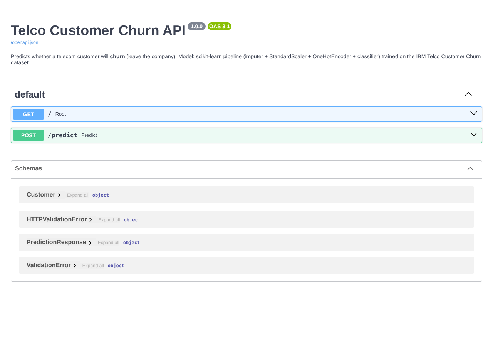
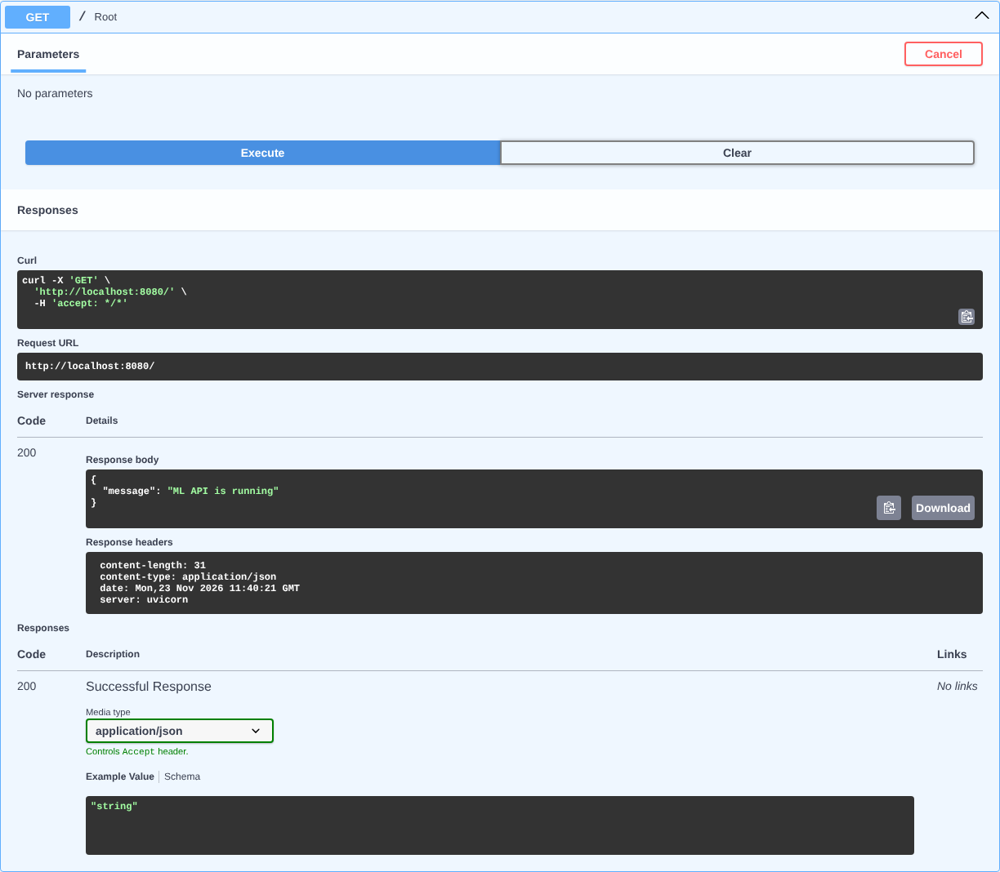
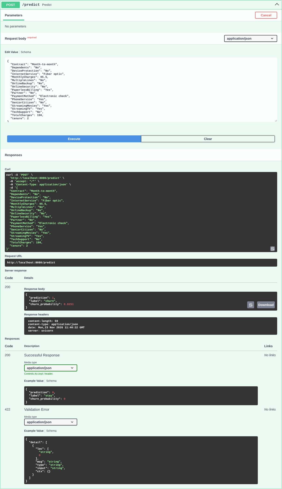

# ML model deployment with FastAPI and Docker

A customer-churn classifier is trained on the **IBM Telco Customer Churn** dataset, saved as `model.joblib`,
served by a **FastAPI** app and packaged in a **Docker** container.

## Dataset

[IBM Telco Customer Churn](https://github.com/IBM/telco-customer-churn-on-icp4d/blob/master/data/Telco-Customer-Churn.csv)
(`data/telco_customer_churn.csv`): 7,043 customers of a telecom company, 21 columns.
Target `Churn` = the customer left within the last month (26.5% of customers, so the classes are imbalanced).

| Group | Features |
|---|---|
| Account | `tenure` (months), `Contract`, `PaperlessBilling`, `PaymentMethod`, `MonthlyCharges`, `TotalCharges` |
| Services | `PhoneService`, `MultipleLines`, `InternetService`, `OnlineSecurity`, `OnlineBackup`, `DeviceProtection`, `TechSupport`, `StreamingTV`, `StreamingMovies` |
| Demographics | `SeniorCitizen`, `Partner`, `Dependents` |

`customerID` (identifier) and `gender` (sensitive attribute) are not used. `TotalCharges` is blank for 11 new
customers with `tenure = 0`; it is converted to a number and the gap is filled by a median imputer inside the pipeline.

## Project structure

```
ml-fastapi-docker/
├── main.py              # FastAPI app: GET / and POST /predict
├── train.py             # trains the model and saves model.joblib
├── model.joblib         # trained model artifact (sklearn Pipeline)
├── metrics.json         # hold-out metrics written by train.py
├── requirements.txt     # runtime dependencies (used by Docker)
├── requirements-dev.txt # + pytest/httpx for the tests
├── Dockerfile
├── .dockerignore
├── data/telco_customer_churn.csv
├── tests/test_api.py    # API tests
├── screenshots/         # Swagger UI tested against the running container
└── README.md
```

## Step 1. Train the model

```bash
python -m venv .venv
source .venv/bin/activate          # Windows: .venv\Scripts\activate
pip install -r requirements-dev.txt
python train.py
```

Preprocessing (median imputer + StandardScaler for numeric features, OneHotEncoder for categorical ones) and the
classifier are put into one scikit-learn `Pipeline`, so the saved artifact accepts raw feature values from the API.
Three models are compared on a stratified 80/20 hold-out split. The best one by ROC-AUC is refit on all data and saved:

| Model | Accuracy | F1 (churn) | ROC-AUC |
|---|---|---|---|
| LogisticRegression (class_weight=balanced) | 0.737 | 0.612 | 0.842 |
| RandomForest (300 trees, class_weight=balanced) | 0.765 | 0.639 | 0.842 |
| **GradientBoosting** | **0.802** | 0.583 | **0.843** |

Selected model: **GradientBoosting** (churn precision 0.66, recall 0.52 at threshold 0.5).
The ROC-AUC of the three models is almost the same; the API also returns the churn probability, so the decision
threshold can be chosen by the business (e.g. lower it to catch more churners).

Result: `model.joblib` and `metrics.json`.

## Step 2. FastAPI application (`main.py`)

| Method | Path | Description |
|---|---|---|
| GET | `/` | returns `{"message": "ML API is running"}` |
| POST | `/predict` | accepts the customer's features, returns the prediction |
| GET | `/docs` | Swagger UI (generated by FastAPI) |

The model is loaded from `model.joblib` once at startup (FastAPI `lifespan`). The request body is validated by a
Pydantic model: numbers are range-checked and categorical fields only accept the values present in the dataset
(Swagger lists them), otherwise the API answers `422`.

Example request (new customer, fiber optic, month-to-month contract):

```json
{
  "SeniorCitizen": "No", "Partner": "No", "Dependents": "No", "tenure": 2,
  "PhoneService": "Yes", "MultipleLines": "No", "InternetService": "Fiber optic",
  "OnlineSecurity": "No", "OnlineBackup": "No", "DeviceProtection": "No", "TechSupport": "No",
  "StreamingTV": "Yes", "StreamingMovies": "Yes", "Contract": "Month-to-month",
  "PaperlessBilling": "Yes", "PaymentMethod": "Electronic check",
  "MonthlyCharges": 95.5, "TotalCharges": 190.0
}
```

Response:

```json
{"prediction": 1, "label": "churn", "churn_probability": 0.8251}
```

A loyal customer (5 years, two-year contract, DSL with security and tech support, automatic bank transfer) gets
`{"prediction": 0, "label": "stay", "churn_probability": 0.0262}`.

Allowed values of the categorical fields:

| Field | Values |
|---|---|
| SeniorCitizen, Partner, Dependents, PhoneService, PaperlessBilling | `Yes`, `No` |
| MultipleLines | `Yes`, `No`, `No phone service` |
| InternetService | `DSL`, `Fiber optic`, `No` |
| OnlineSecurity, OnlineBackup, DeviceProtection, TechSupport, StreamingTV, StreamingMovies | `Yes`, `No`, `No internet service` |
| Contract | `Month-to-month`, `One year`, `Two year` |
| PaymentMethod | `Electronic check`, `Mailed check`, `Bank transfer (automatic)`, `Credit card (automatic)` |

## Step 3. Run the API locally with Uvicorn

```bash
uvicorn main:app --reload
```

- http://127.0.0.1:8000/ → `{"message":"ML API is running"}`
- http://127.0.0.1:8000/docs → Swagger UI: open `POST /predict` → *Try it out* → *Execute*
- or from the terminal:

```bash
curl -X POST http://127.0.0.1:8000/predict -H "Content-Type: application/json" \
  -d '{"SeniorCitizen":"No","Partner":"No","Dependents":"No","tenure":2,"PhoneService":"Yes","MultipleLines":"No","InternetService":"Fiber optic","OnlineSecurity":"No","OnlineBackup":"No","DeviceProtection":"No","TechSupport":"No","StreamingTV":"Yes","StreamingMovies":"Yes","Contract":"Month-to-month","PaperlessBilling":"Yes","PaymentMethod":"Electronic check","MonthlyCharges":95.5,"TotalCharges":190.0}'
```

Automated tests (root, predict, a sanity check that the risky customer gets a higher churn probability than the
loyal one, invalid input → 422, docs page):

```bash
pytest -q        # 5 passed
```

## Step 4. Dockerfile

The `Dockerfile` uses the `python:3.13-slim` base image, sets `/app` as the working directory, installs
`requirements.txt` (in a separate layer, so it is cached), copies `main.py` and `model.joblib` and starts the app
with `uvicorn main:app --host 0.0.0.0 --port 8000`. Library versions are pinned, so the model is loaded with the
same scikit-learn version it was trained with.

## Step 5. Build the image

```bash
docker build -t ml-fastapi-docker:1.0 .
docker images ml-fastapi-docker
```

## Step 6. Run the container

```bash
docker run -d --name churn-api -p 8080:8000 ml-fastapi-docker:1.0
docker ps
curl http://localhost:8080/
```

Then test again: http://localhost:8080/, `POST http://localhost:8080/predict` and http://localhost:8080/docs.

Stop and remove: `docker stop churn-api && docker rm churn-api`.

### Results inside the container

Swagger UI served by the container:



`GET /`:



`POST /predict`:



Container log:

```
INFO:     Application startup complete.
INFO:     Uvicorn running on http://0.0.0.0:8000 (Press CTRL+C to quit)
INFO:     172.17.0.1:50006 - "GET /docs HTTP/1.1" 200 OK
INFO:     172.17.0.1:50006 - "GET / HTTP/1.1" 200 OK
INFO:     172.17.0.1:50006 - "POST /predict HTTP/1.1" 200 OK
```
